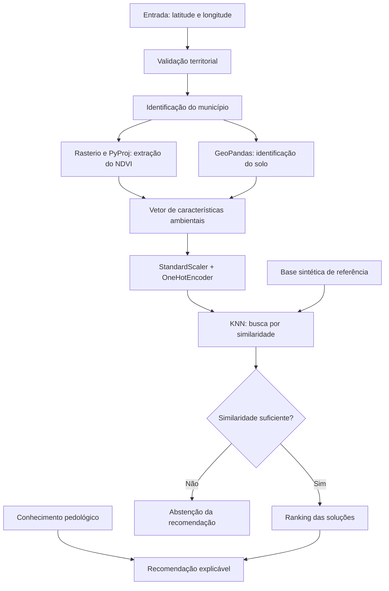

<p align="center">
  <a href="https://ftl-brazil-2026.github.io/ebook/course-info/general-info.html">
    
  </a>
</p>

# Caatinga Agroforestry Recommender

### Inteligência Artificial aplicada à recuperação ambiental e à agropecuária sustentável na Caatinga


Projeto desenvolvido no contexto do [FTL Brasil SpaceTech Bootcamp 2026](https://ftl-brazil-2026.github.io/ebook/course-info/general-info.html).

## Sobre o projeto

O projeto propõe a utilização de inteligência artificial, sensoriamento remoto e ciência de dados como ferramentas de apoio à recuperação de pastagens degradadas no bioma Caatinga, conciliando conservação ambiental, desenvolvimento econômico e agropecuária sustentável.

Foi desenvolvido um **protótipo funcional de sistema de recomendação agroflorestal**, fundamentado no algoritmo K-Nearest Neighbors (KNN), capaz de receber coordenadas geográficas, identificar características ambientais e sugerir estratégias candidatas de recuperação por similaridade.

A proposta busca demonstrar como dados ambientais provenientes de observações da Terra podem ser integrados a técnicas de Machine Learning para apoiar processos de tomada de decisão.

## Objetivos

- Integrar dados de sensoriamento remoto e informações pedológicas.
- Caracterizar o comportamento histórico da vegetação por meio do NDVI.
- Desenvolver um sistema de recomendação baseado em similaridade ambiental.
- Identificar estratégias candidatas de recuperação de pastagens.
- Incorporar conhecimento pedológico à interpretação das recomendações.
- Demonstrar a viabilidade computacional da solução.
- Contribuir para os Objetivos de Desenvolvimento Sustentável da Agenda 2030.

## Objetivos de Desenvolvimento Sustentável

O projeto está alinhado principalmente aos seguintes ODS:

| ODS | Objetivo | Contribuição proposta |
|---|---|---|
| ODS 2 | Fome Zero e Agricultura Sustentável | Incentivo a sistemas produtivos sustentáveis |
| ODS 8 | Trabalho Decente e Crescimento Econômico | Apoio ao desenvolvimento econômico regional |
| ODS 13 | Ação Contra a Mudança Global do Clima | Apoio à recuperação ambiental e à resiliência climática |
| ODS 15 | Vida Terrestre | Conservação do solo e recuperação de ecossistemas degradados |

## Região piloto

A região de estudo corresponde ao **Submédio São Francisco**, abrangendo quatro municípios do estado da Bahia:

- Juazeiro;
- Casa Nova;
- Curaçá;
- Sobradinho.

A delimitação territorial foi realizada no Google Earth Engine, utilizando a base de limites administrativos FAO GAUL 2015.

A seleção dessa região considera sua relevância para a produção agropecuária, as condições climáticas semiáridas e os desafios associados à conservação dos recursos naturais.

## Dados

O projeto utiliza dados ambientais públicos, arquivos derivados de processamento geoespacial e uma base sintética desenvolvida exclusivamente para a prova de conceito.

| Dataset | Fonte | Formato | Finalidade |
|---|---|---|---|
| Limites administrativos | FAO GAUL | GeoJSON | Delimitação da região piloto |
| Imagem de satélite RGB | Sentinel-2 | GeoTIFF | Visualização territorial |
| NDVI histórico | NASA MODIS MOD13Q1 V6.1 | GeoTIFF | Caracterização vegetativa |
| Features históricas de NDVI | Processamento próprio | GeoTIFF | Entrada numérica do KNN |
| Mapeamento pedológico | IBGE | GeoPackage | Identificação espacial dos solos |
| Caracterização pedológica | Planilha de referência Embrapa Solos / SiBCS | XLSX | Conhecimento ambiental complementar |
| Cenários de referência | Elaboração própria | CSV | Base sintética de similaridade |

### Características dos dados ambientais

| Parâmetro | Especificação |
|---|---|
| Produto orbital | MODIS MOD13Q1 V6.1 |
| Plataforma | Terra |
| Período histórico | 2021–2025 |
| Resolução espacial nominal | 250 metros |
| Resolução temporal original | 16 dias |
| Composições anuais | 5 |
| Unidades pedológicas | 261 |
| Municípios analisados | 4 |
| Features originais do KNN | 5 |
| Cenários sintéticos de referência | 12 |

## Metodologia

A metodologia foi estruturada em etapas de aquisição, processamento, engenharia de características, implementação de Machine Learning e validação funcional.

### 1. ETL e engenharia de dados

O processamento foi organizado segundo a metodologia ETL (Extract, Transform, Load).

**Extract**

- Aquisição de imagens orbitais no Google Earth Engine.
- Extração dos limites administrativos da FAO.
- Aquisição da base vetorial de solos do IBGE.
- Organização das informações pedológicas de referência.

**Transform**

- Delimitação e recorte espacial da região piloto.
- Controle de qualidade das observações MODIS.
- Aplicação do fator de escala do NDVI.
- Tratamento de valores ausentes e NoData.
- Verificação da validade das geometrias.
- Compatibilização dos sistemas de coordenadas.
- Padronização das categorias de solo.
- Construção das características ambientais.

**Load**

- Exportação dos limites territoriais em GeoJSON.
- Exportação dos rasters ambientais em GeoTIFF.
- Armazenamento do mapa pedológico em GeoPackage.
- Organização dos cenários de referência em CSV.
- Carregamento dos datasets no ambiente Python.

### 2. Otimização do processamento geoespacial

Inicialmente, foram utilizadas imagens Sentinel-2 para a caracterização visual da região piloto e para os primeiros experimentos de processamento histórico do NDVI. Posteriormente, optou-se pelo produto MODIS MOD13Q1 V6.1 para a construção da série histórica.

O produto MODIS disponibiliza o NDVI previamente calculado, permitindo reduzir a complexidade computacional sem alterar o período histórico analisado.

### 3. Análise Exploratória de Dados (EDA)

A análise exploratória contemplou:

- Distribuição das classes pedológicas.
- Disponibilidade temporal das observações de NDVI.
- Identificação de valores ausentes.
- Consistência das variáveis ambientais.
- Validação das geometrias vetoriais.
- Comportamento histórico da vegetação.

Após o recorte geográfico da base pedológica, foram identificadas 261 unidades de mapeamento.

| Classe de solo | Unidades pedológicas |
|---|---:|
| Neossolo | 129 |
| Argissolo | 34 |
| Latossolo | 29 |
| Planossolo | 18 |
| Cambissolo | 12 |
| Luvissolo | 11 |
| Vertissolo | 8 |
| Sem classificação | 20 |
| **Total** | **261** |

As quantidades representam unidades de mapeamento, e não a extensão territorial ocupada por cada classe.

### 4. Feature Engineering

O NDVI (Normalized Difference Vegetation Index) foi utilizado como indicador do comportamento vegetativo.

$$
NDVI = \frac{NIR-RED}{NIR+RED}
$$

A partir da série histórica de 2021 a 2025, foram construídas quatro características numéricas, complementadas pela classificação pedológica da localização.

| Feature | Tipo | Descrição |
|---|---|---|
| `ndvi_2025` | Float | Mediana anual do NDVI em 2025 |
| `ndvi_media_historica` | Float | Média das medianas anuais entre 2021 e 2025 |
| `ndvi_std_historico` | Float | Desvio padrão interanual do NDVI |
| `ndvi_tendencia` | Float | Tendência temporal estimada do NDVI |
| `classe_solo` | Categórica | Classificação pedológica da localização |

A tendência temporal foi calculada por meio do coeficiente angular de uma regressão linear simples:

$$
NDVI_t = \beta_0 + \beta_1t + \varepsilon_t
$$

O coeficiente beta representa a variação anual estimada do índice vegetativo.

As estatísticas históricas foram calculadas considerando pixels com dados válidos nos cinco anos analisados.

## Sistema de recomendação

### Base de referência

Para a demonstração computacional, foi construída uma base sintética contendo 12 cenários ambientais associados a três estratégias de recuperação.

| Estratégia | Sigla | Cenários |
|---|---|---:|
| Sistema Silvipastoril | IPF | 4 |
| Sistema Agrossilvipastoril | ILPF | 4 |
| Regeneração Natural Assistida | RNA | 4 |
| **Total** | | **12** |

A base foi estruturada utilizando as mesmas características ambientais recuperadas durante as consultas geográficas.

> **Importante:** os cenários de referência são sintéticos e foram desenvolvidos exclusivamente para demonstrar a lógica computacional do sistema. Não representam casos reais de sucesso agronômico comprovado.

### Pré-processamento

As variáveis numéricas foram padronizadas utilizando o `StandardScaler`, enquanto a variável categórica de solo foi transformada por meio do `OneHotEncoder`.

As transformações foram integradas utilizando o `ColumnTransformer` da biblioteca Scikit-Learn.

A padronização foi ajustada exclusivamente sobre a base de referência e reutilizada para transformar as consultas posteriores.

### Algoritmo K-Nearest Neighbors

O motor de recomendação utiliza a implementação `NearestNeighbors`, da biblioteca Scikit-Learn.

A escolha do algoritmo considera sua simplicidade computacional, interpretabilidade e capacidade de identificar registros ambientalmente semelhantes.

| Parâmetro | Configuração |
|---|---|
| Algoritmo | K-Nearest Neighbors |
| Implementação | `NearestNeighbors` |
| Número de vizinhos (K) | 3 |
| Métrica | Distância euclidiana ponderada |
| Método de busca | Brute force |
| Fator das variáveis de NDVI | 1.0 |
| Fator da variável pedológica | 2.0 |
| Distância máxima | 4.0 |
| Ponderação dos vizinhos | Inverso da distância |

### Cálculo da similaridade

A similaridade é determinada pela distância euclidiana entre as características ambientais transformadas.

$$
d(x,y) = \sqrt{\sum_{i=1}^{n}[a_i(x_i-y_i)]^2}
$$

Quanto menor a distância, maior a similaridade entre a área consultada e o cenário de referência.

Para a construção do ranking, os vizinhos recebem pesos inversamente proporcionais às respectivas distâncias:

$$
w_i = \frac{1}{d_i+\varepsilon}
$$

Os pesos são agrupados por estratégia e normalizados para gerar uma pontuação relativa.

A solução com maior pontuação é apresentada como candidata à avaliação técnica.

Quando nenhuma referência atende ao limiar estabelecido, o sistema se abstém de recomendar.

## Arquitetura do sistema



As coordenadas são utilizadas exclusivamente para recuperar as características ambientais da localização. Elas não entram diretamente no cálculo de similaridade do KNN.

## Análise de sensibilidade

Foi realizada uma análise de sensibilidade para avaliar a influência da variável pedológica no comportamento do algoritmo.

O experimento foi conduzido em uma localização no município de Juazeiro, cuja classe de solo identificada foi Vertissolo.

| Fator do solo | IPF | ILPF | Vizinhos da mesma classe de solo |
|---|---:|---:|---:|
| 1.0 | 100% | 0% | 0 |
| 1.5 | 100% | 0% | 0 |
| 2.0 | 67,09% | 32,91% | 1 |

O fator 2.0 foi adotado por ampliar a influência da classificação pedológica e recuperar uma referência da mesma classe de solo, preservando a primeira solução candidata.

Essa escolha possui natureza experimental e não representa uma otimização agronômica validada.

## Resultados

A validação funcional foi realizada mediante consultas geográficas em quatro localizações, selecionadas automaticamente a partir dos polígonos dos municípios da região piloto.

| Município | Solo | NDVI 2025 | Distância mínima | Recomendação | Pontuação relativa |
|---|---|---:|---:|---|---:|
| Casa Nova | Latossolo | 0,4162 | 1,1334 | ILPF | 100,00% |
| Curaçá | Cambissolo | 0,2848 | 1,7088 | IPF | 60,58% |
| Juazeiro | Planossolo | 0,3083 | 3,0041 | IPF | 66,05% |
| Sobradinho | Argissolo | 0,4712 | 4,5445 | Similaridade insuficiente | — |

### Desempenho funcional

| Indicador | Resultado |
|---|---:|
| Localizações testadas | 4 |
| Recomendações geradas | 3 |
| Abstenções | 1 |
| Taxa de recomendação na amostra | 75% |
| Taxa de abstenção na amostra | 25% |

Os resultados demonstram a capacidade do sistema de gerar recomendações distintas conforme as características ambientais das localizações consultadas.

A abstenção observada em Sobradinho evidencia o funcionamento do mecanismo de restrição por similaridade insuficiente.

As taxas apresentadas descrevem exclusivamente o comportamento funcional nas localizações testadas e não representam métricas de acurácia.

## Demonstração do protótipo

Exemplo de consulta realizada no município de Juazeiro:

```text
CAATINGA - AGROFORESTRY RECOMMENDER

Latitude:  -9.6500
Longitude: -40.3500

Município: Juazeiro
Classe de solo: VERTISSOLO

CARACTERÍSTICAS AMBIENTAIS

NDVI 2025:          0.2088
NDVI médio:         0.2546
Desvio padrão:      0.0302
Tendência anual:   -0.0118

RANKING DAS SOLUÇÕES

Sistema Silvipastoril:       67.09%
Sistema Agrossilvipastoril:  32.91%

SOLUÇÃO CANDIDATA

Sistema Silvipastoril (IPF)

Distância mínima: 3.3508
Risco pedológico de degradação: Alto
```

Além do ranking, o sistema disponibiliza informações pedológicas complementares, incluindo:

- Textura predominante.
- Profundidade efetiva.
- Fertilidade natural.
- Drenagem interna.
- Risco de degradação.
- Vulnerabilidades ambientais.
- Aptidão e manejo recomendado.

Essas informações complementam a interpretação da recomendação, sem constituir um filtro agronômico automático.

## Tecnologias utilizadas

| Tecnologia | Aplicação |
|---|---|
| Google Earth Engine | Processamento de dados orbitais |
| JavaScript | Aquisição e processamento geoespacial no GEE |
| Python | Desenvolvimento do protótipo |
| Google Colab | Ambiente de execução |
| Pandas | Manipulação e análise de dados |
| NumPy | Operações numéricas |
| GeoPandas | Processamento vetorial geoespacial |
| Rasterio | Consulta de dados raster |
| PyProj | Transformação de coordenadas |
| Shapely | Operações geométricas |
| Pyogrio | Leitura de dados geoespaciais |
| Scikit-Learn | Machine Learning e pré-processamento |
| Matplotlib | Visualização dos resultados |
| OpenPyXL | Leitura de arquivos XLSX |

## Como começar

O protótipo foi desenvolvido para execução no Google Colab, sem necessidade de infraestrutura adicional, banco de dados externo ou serviços em nuvem durante as consultas.

### 1. Dependências

```bash
pip install pandas numpy geopandas rasterio pyproj shapely pyogrio scikit-learn matplotlib openpyxl
```

### 2. Dados necessários

Os seguintes arquivos devem estar disponíveis no ambiente de execução:

```text
regiao_piloto.geojson
Features_NDVI_KNN_Submedio_SF_MODIS.tif
Solos_Submedio_SF_KNN.gpkg
Submedio_Sao_Francisco_Caracteristicas_e_Solos_Embrapa.xlsx
Casos_Referencia_Simulados.csv
```

No Google Colab, carregue os arquivos no diretório `/content` ou no diretório raiz, conforme a configuração do notebook.

### 3. Execução

Abra o notebook do protótipo e execute as células sequencialmente.

O notebook contempla:

1. Instalação das dependências.
2. Importação das bibliotecas.
3. Carregamento e validação dos dados.
4. Processamento geoespacial.
5. Engenharia de dados e pré-processamento.
6. Implementação do KNN.
7. Construção do ranking.
8. Integração pedológica.
9. Sistema de recomendação.
10. Testes funcionais.
11. Seleção automática de pontos de demonstração.
12. Execução interativa.

### 4. Consulta direta

Após inicializar o sistema, é possível realizar uma consulta por meio da função:

```python
resultado = recomendar(
    latitude=-9.6500,
    longitude=-40.3500
)
```

A execução retorna as características ambientais da localização, os vizinhos mais próximos, o ranking de soluções, a recomendação candidata e suas limitações.

## Estrutura do projeto

Organização sugerida para reprodução e documentação do protótipo:

```text
.
├── assets/
│   └── logos_ftl.png
│
├── dados/
│   ├── regiao_piloto.geojson
│   ├── Recorte_RGB_Submedio_SF.tif
│   ├── NDVI_Historico_2021_2025_MODIS.tif
│   ├── Features_NDVI_KNN_Submedio_SF_MODIS.tif
│   ├── Solos_Submedio_SF_KNN.gpkg
│   ├── Submedio_Sao_Francisco_Caracteristicas_e_Solos_Embrapa.xlsx
│   └── Casos_Referencia_Simulados.csv
│
├── notebooks/
│   └── Prototipo_KNN_Caatinga.ipynb
│
├── gee/
│   └── processamento_ndvi.js
│
├── resultados/
│   └── Validacao_Final_KNN_Caatinga.png
│
└── README.md
```

## Limitações

O sistema constitui uma prova de conceito computacional e apresenta as seguintes limitações:

- Utilização de 12 cenários sintéticos de referência.
- Ausência de validação agronômica em campo.
- Resolução espacial nominal de 250 metros dos dados MODIS.
- Escala regional de mapeamento dos solos.
- Ausência de identificação automática de pastagens efetivamente degradadas.
- Ausência de variáveis climáticas e econômicas adicionais.
- Parâmetros de ponderação e limiar de distância definidos experimentalmente.
- Quantidade reduzida de localizações utilizadas na validação funcional.

As recomendações não constituem prescrições definitivas de manejo, devendo ser submetidas à avaliação técnica especializada.

As pontuações relativas não representam probabilidades de sucesso.

## Trabalhos futuros

- Construção de uma base de casos reais de sucesso agroflorestal.
- Integração com dados de uso e cobertura da terra.
- Identificação espacial de pastagens degradadas.
- Incorporação de variáveis climáticas e topográficas.
- Avaliação da similaridade em diferentes regiões da Caatinga.
- Validação científica e agronômica das recomendações.
- Desenvolvimento de uma interface geoespacial interativa.
- Integração com plataformas de apoio à tomada de decisão.

## Conclusão

O desenvolvimento demonstrou a viabilidade computacional de integrar dados de observação da Terra, processamento geoespacial e Machine Learning em um sistema inteligente de recomendação agroflorestal.

Por meio do K-Nearest Neighbors, foi possível transformar coordenadas geográficas em características ambientais e identificar estratégias candidatas de recuperação por similaridade.

A prova de conceito estabelece uma base tecnológica para o desenvolvimento futuro de soluções orientadas por dados, capazes de apoiar a conservação ambiental, a recuperação de áreas degradadas e a promoção da agropecuária sustentável na Caatinga.

## Referências

**Observação da Terra e sensoriamento remoto**

- [Google Earth Engine](https://earthengine.google.com/)
- [NASA MODIS](https://modis.gsfc.nasa.gov/)
- [MODIS MOD13Q1 V6.1 — Earth Engine Data Catalog](https://developers.google.com/earth-engine/datasets/catalog/MODIS_061_MOD13Q1)
- [Copernicus Sentinel-2](https://sentinels.copernicus.eu/)
- [FAO GAUL 2015](https://developers.google.com/earth-engine/datasets/catalog/FAO_GAUL_2015_level2)

**Dados ambientais e pedológicos**

- [IBGE — Banco de Dados de Informações Ambientais](https://bdiaweb.ibge.gov.br/)
- [IBGE — Repositório de dados de pedologia](https://geoftp.ibge.gov.br/informacoes_ambientais/pedologia/)
- [Embrapa Solos](https://www.embrapa.br/solos)
- [MapBiomas Brasil](https://brasil.mapbiomas.org/) — referência para trabalhos futuros.

**Machine Learning e geoprocessamento**

- [Scikit-Learn — Nearest Neighbors](https://scikit-learn.org/stable/modules/neighbors.html)
- [Scikit-Learn — StandardScaler](https://scikit-learn.org/stable/modules/generated/sklearn.preprocessing.StandardScaler.html)
- [GeoPandas Documentation](https://geopandas.org/)
- [Rasterio Documentation](https://rasterio.readthedocs.io/)
- [PyProj Documentation](https://pyproj4.github.io/pyproj/)

**Desenvolvimento sustentável**

- [Objetivos de Desenvolvimento Sustentável — Nações Unidas](https://sdgs.un.org/goals)
- [Programa das Nações Unidas para o Desenvolvimento](https://www.undp.org/)
- [FTL Brasil SpaceTech Bootcamp 2026](https://ftl-brazil-2026.github.io/ebook/course-info/general-info.html)
