# Caatinga <!--{ as="image" mode="hero" src="./assets/cacto.jpg" style="background-size:contain;background-repeat:no-repeat;background-position:center;" }-->

## O que é a Caatinga?

  

    IMPACTOS SOBRE O BIOMA
  

  

    Degradação na Caatinga
  

  

    

      

        Degradação por pastagens
        
          <a href="https://www.researchgate.net/publication/391404484_DEGRADACAO_DE_PASTAGENS_CAUSAS_CONSEQUENCIAS_E_CAMINHO_PARA_A_RECUPERACAO" target="_blank" rel="noopener noreferrer" style="color:#806331; text-decoration:none;">[1]</a>
        
      

      

        Associada ao manejo inadequado das áreas destinadas à pecuária.
      

      

      <ul style="font-size:13px; line-height:1.9; padding-left:18px;">
        <li>Superpastejo;</li>
        <li>Compactação do solo;</li>
        <li>Redução da cobertura vegetal;</li>
        <li>Perda da fertilidade do solo;</li>
        <li>Manejo inadequado das pastagens.</li>
      </ul>
    

    

      

        Degradação ambiental
      

      

        Deterioração dos recursos naturais e do equilíbrio dos ecossistemas.
      

      

      <ul style="font-size:13px; line-height:1.9; padding-left:18px;">
        <li>Desmatamento;</li>
        <li>Queimadas;</li>
        <li>Erosão do solo;</li>
        <li>Perda de biodiversidade;</li>
        <li>Exploração excessiva dos recursos naturais.</li>
      </ul>
    

  

  

    Ambos os processos comprometem a resiliência ambiental e podem intensificar a desertificação da Caatinga.
  

## Expandir Sem Destruir

O objetivo é promover a agropecuária sustentável na Caatinga como estratégia de redução do desmatamento.

  

    Transformação da paisagem na Caatinga
  

  

    

      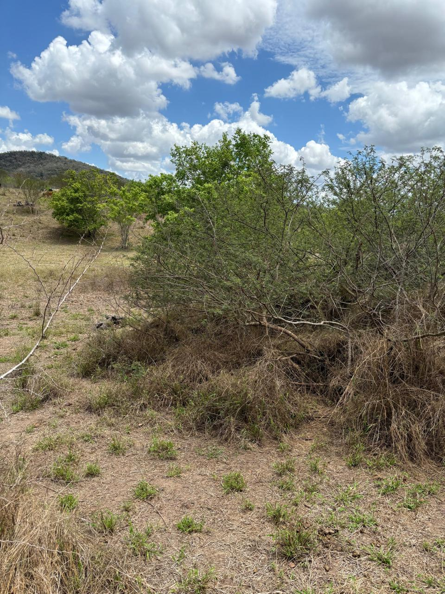
      

        ÁREA DEGRADADA
      

      

        Perda da cobertura vegetal e exposição do solo.
      

      

        📍 <strong>Localização:</strong> Antônio Cardoso – BA, Brasil.
      

    

    

      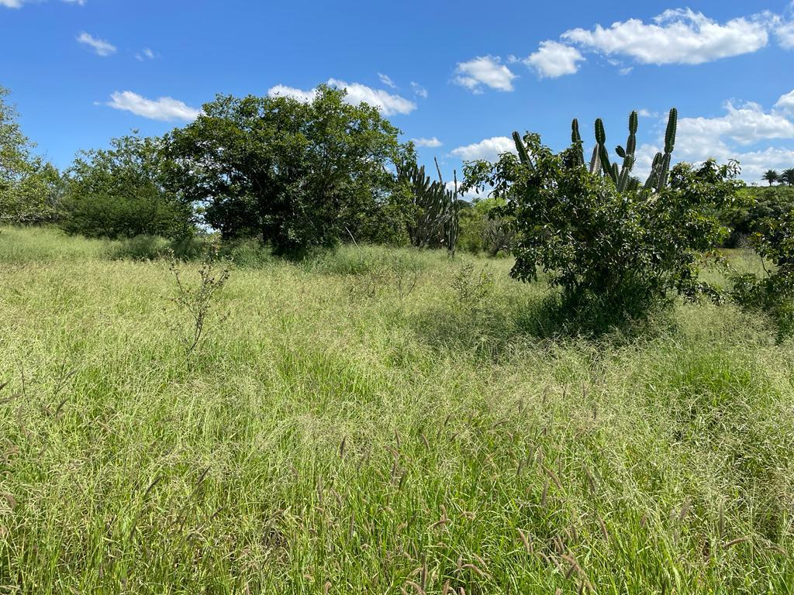
      

        VEGETAÇÃO RESTAURADA
      

      

        Após o manejo correto na região.
      

    

  

## Uma fazenda sustentável na Caatinga <!--{ as="img" mode="tour" style="object-fit:scale-down !important; object-position:center !important; image-rendering:auto; filter:none !important; background-color:#18251c;" }-->

### <!--{ src="./assets/fazenda.jpeg" style="background:rgba(0,0,0,0.45); backdrop-filter:blur(4px); -webkit-backdrop-filter:blur(4px); color:white;" }-->
#### Pecuária sustentável na Caatinga <!--{ style="font-size:18px;color:white;" }-->

A integração entre a criação de animais e a vegetação arbórea contribui para a conservação ambiental, o conforto térmico animal e a sustentabilidade da atividade pecuária. <!--{ style="font-size:14px;line-height:1.6;color:#f3f3f3;" }-->

📍 **Fazenda Cajazeira — Mundo Novo, BA.** <!--{ style="font-size:12px;color:#f3f3f3;" }-->

### <!--{ src="./assets/pastejo.jpeg" style="background:#fff0c4; margin-left:auto !important; margin-right:5% !important; align-self:flex-end;" }-->

MANEJO REGENERATIVO <!--{ style="font-size:11px;letter-spacing:2px;color:#887344;margin-bottom:8px;" }-->

**350 dias** <!--{ style="font-size:28px;color:#465332;margin:0;line-height:1.2;" }-->

De descanso das pastagens por ano. <!--{ style="font-size:13px;color:#786747;line-height:1.5;" }-->

&nbsp; <!--{ style="height:8px;background:linear-gradient(to right,#a68143 4.1%,#626c40 4.1%);border-radius:5px;margin:12px 0 5px;" }-->

15 dias de ocupação | 350 de descanso <!--{ style="font-size:10px;color:#786747;margin:0;" }-->

---

O descanso das pastagens favorece a regeneração vegetal e a conservação do solo. <!--{ style="font-size:14px;line-height:1.6;color:#493c24;" }-->

---

📍 **Fazenda Cajazeira** <!--{ style="font-size:12px;color:#493c24;margin-bottom:0;" }-->

Mundo Novo — Bahia, Brasil. <!--{ style="font-size:11px;color:#786747;margin-top:0;" }-->

### <!--{ src="./assets/800.jpeg" style="background: #fff0c4;" }-->
#### Pecuária e Balanço de Carbono

PECUÁRIA DE BAIXO CARBONO <!--{ style="font-size:11px;letter-spacing:2px;color:#887344;margin-bottom:8px;" }-->

**800 kg de CO₂** <!--{ style="font-size:28px;color:#465332;margin:0;line-height:1.2;" }-->

Saldo positivo declarado por bezerro produzido. <!--{ style="font-size:13px;color:#786747;line-height:1.5;" }-->

---

A integração entre árvores e pecuária favorece o sequestro de carbono e a conservação ambiental. <!--{ style="font-size:14px;line-height:1.6;color:#493c24;" }-->

---

📍 **Fazenda Cajazeira** <!--{ style="font-size:12px;color:#493c24;margin-bottom:0;" }-->

Mundo Novo — Bahia, Brasil. <!--{ style="font-size:11px;color:#786747;margin-top:0;" }-->

## Pecuária Regenerativa na Prática

  

    “Acredito que o grande desafio está na agricultura em larga escala e suas monoculturas nefastas. A pecuária já encontrou seus modelos regenerativos baseados na biodiversidade e tendo os ruminantes como aliados na produção de proteína animal a partir da fotossíntese. <strong><em>São as bactérias do rúmen transformando a biomassa forrageira em leite, carne e recursos para a humanidade</em></strong>”.
  

  — Dr. Guto Trindade
    <a href="https://www.instagram.com/gutotrindade.cajazeira?evlk=OTdtYXFxemNmdmc2" target="_blank" rel="noopener noreferrer" style="color:#806331; text-decoration:none;">[2]</a>
  

## Quais são os impactos?

  

    DESENVOLVIMENTO RURAL E RESILIÊNCIA TERRITORIAL
  

  

    Impactos socioeconômicos
  

  

    A recuperação produtiva de áreas degradadas na Caatinga pode gerar ganhos econômicos, fortalecer a agricultura familiar, ampliar empregos qualificados e aumentar a resiliência das comunidades rurais.
  

  

  

      
INVESTIMENTO INICIAL

      
R$ 6,2 bi

    

  

      
EM 15 ANOS

      
R$ 31,2 bi

    

   

      
IMÓVEIS MAPEADOS

      
46 mil

    

  

      
APTOS A SAFs

      
31 mil

    

  

      
APTOS À PECUÁRIA DE LEITE

      
25 mil

    

  

  

  

      

        Impactos econômicos e produtivos
      

  <ul style="font-size:14px; line-height:1.7; padding-left:18px; margin:0;">
        <li><strong>Maior rentabilidade e valorização da terra:</strong> tecnologias e manejo intensivo elevam a produtividade por hectare e melhoram o retorno financeiro.</li>
        <li><strong>Diversificação de receitas:</strong> sistemas integrados combinam fluxos de curto, médio e longo prazo, reduzindo riscos produtivos e de mercado.</li>
        <li><strong>Bem-estar animal e ganho zootécnico:</strong> o sombreamento em sistemas silvipastoris reduz o estresse térmico e melhora ganho de peso, reprodução e produção leiteira.</li>
        <li><strong>Efeito multiplicador local:</strong> os investimentos movimentam viveiros, insumos, assistência técnica, transporte, armazenagem e agroindústrias regionais.</li>
        <li><strong>Acesso a mercados premium e finanças verdes:</strong> produção rastreada, de baixa emissão e livre de desmatamento amplia o acesso a crédito, mercados internacionais, PSA e créditos de carbono.</li>
      </ul>
    

  

      

        Impactos sociais e territoriais
      

  <ul style="font-size:14px; line-height:1.7; padding-left:18px; margin:0;">
        <li><strong>Inclusão produtiva da agricultura familiar:</strong> áreas prioritárias favorecem pequenos e médios produtores, elevando a renda e ajudando a conter o êxodo rural.</li>
        <li><strong>Geração e qualificação de empregos:</strong> sistemas intensificados, florestais e agroflorestais demandam mão de obra mais contínua e qualificada no interior.</li>
        <li><strong>Resiliência climática e segurança alimentar:</strong> a integração de atividades adaptadas à Caatinga fortalece o abastecimento regional e reduz a vulnerabilidade das comunidades à seca.</li>
      </ul>
    

  

  Em conjunto, esses efeitos reforçam a agropecuária sustentável como estratégia de desenvolvimento econômico, inclusão social e adaptação climática na Caatinga
    <a href="https://agroicone.com.br/wp-content/uploads/2025/03/pncpd-BA2012.pdf" target="_blank" rel="noopener noreferrer" style="color:#806331; text-decoration:none; font-weight:600;">[3]</a>
  .

## Objetivos de Desenvolvimento Sustentável

  AGENDA 2030

  Objetivos de Desenvolvimento Sustentável

  A agropecuária sustentável na Caatinga contribui para a integração entre conservação ambiental, desenvolvimento econômico e inclusão social.

  

    

      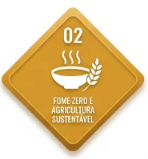
      

        Segurança alimentar
      

      

        Produção agrícola sustentável e fortalecimento da agricultura familiar.
      

    

    

      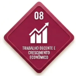
      

        Desenvolvimento econômico
      

      

        Geração de empregos, renda e oportunidades no meio rural.
      

    

    

      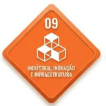
      

        Inovação tecnológica
      

      

        Aplicação de tecnologias e inteligência artificial no setor agropecuário.
      

    

    

      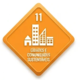
      

        Desenvolvimento territorial
      

      

        Fortalecimento das comunidades rurais e da economia regional.
      

    

    

      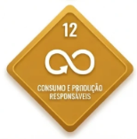
      

        Produção responsável
      

      

        Uso eficiente dos recursos naturais e manejo sustentável.
      

    

    

      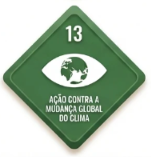
      

        Resiliência climática
      

      

        Mitigação das emissões e adaptação às mudanças climáticas.
      

    

    

      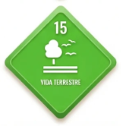
      

        Conservação da Caatinga
      

      

        Redução do desmatamento, recuperação de solos e proteção da biodiversidade.
      

    

    

      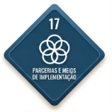
      

        Cooperação institucional
      

      

        Integração entre produtores, instituições de pesquisa e políticas públicas.
      

    

  

## Restaura Caatinga

### Metodologia

O desenvolvimento do projeto foi fundamentado em uma abordagem quantitativa, exploratória e experimental, integrando técnicas de sensoriamento remoto, geoprocessamento, engenharia de dados e aprendizado de máquina (Machine Learning).

  

    PIPELINE DE ENGENHARIA DE DADOS
  

  

    <!-- ETAPA 01 - EXTRACT -->
    

      

        01
      

      

        EXTRACT
      

      

        Coleta de dados
      

      

        Google Earth Engine 
        NASA MODIS 
        FAO 
        IBGE 
        EMBRAPA
      

    

    <!-- SETA 01 -->
    

      <svg width="28" height="20" viewBox="0 0 28 20" style="display:block; overflow:visible;">
        <path d="M2 10 H24 M17 3 L24 10 L17 17" fill="none" stroke="#759482" stroke-width="1.8" stroke-linecap="round" stroke-linejoin="round"/>
      </svg>
    

    <!-- ETAPA 02 - TRANSFORM -->
    

      

        02
      

      

        TRANSFORM
      

      

        Processamento
      

      

        Recorte espacial 
        Controle de qualidade 
        Limpeza 
        Padronização 
        Feature engineering
      

    

    <!-- SETA 02 -->
    

      <svg width="28" height="20" viewBox="0 0 28 20" style="display:block; overflow:visible;">
        <path d="M2 10 H24 M17 3 L24 10 L17 17" fill="none" stroke="#759482" stroke-width="1.8" stroke-linecap="round" stroke-linejoin="round"/>
      </svg>
    

    <!-- ETAPA 03 - LOAD -->
    

      

        03
      

      

        LOAD
      

      

        Dados estruturados
      

      

        GeoJSON 
        GeoTIFF 
        GeoPackage 
        XLSX 
        CSV
      

    

    <!-- SETA 03 -->
    

      <svg width="28" height="20" viewBox="0 0 28 20" style="display:block; overflow:visible;">
        <path d="M2 10 H24 M17 3 L24 10 L17 17" fill="none" stroke="#759482" stroke-width="1.8" stroke-linecap="round" stroke-linejoin="round"/>
      </svg>
    

    <!-- ETAPA 04 - MACHINE LEARNING -->
    

      

        04
      

      

        MACHINE LEARNING
      

      

        Aplicação dos dados
      

      

        KNN
      

      

        K-Nearest Neighbors
      

      

        Sistema de recomendação agroflorestal.
      

    

  

  

  

    Fluxo metodológico do projeto Restaura Caatinga — Elaboração própria.
  

### Recorte

ÁREA DE ESTUDO

Submédio do Rio São Francisco

📍 <strong>Juazeiro, Casa Nova, Curaçá e Sobradinho</strong> — Bahia, Brasil.

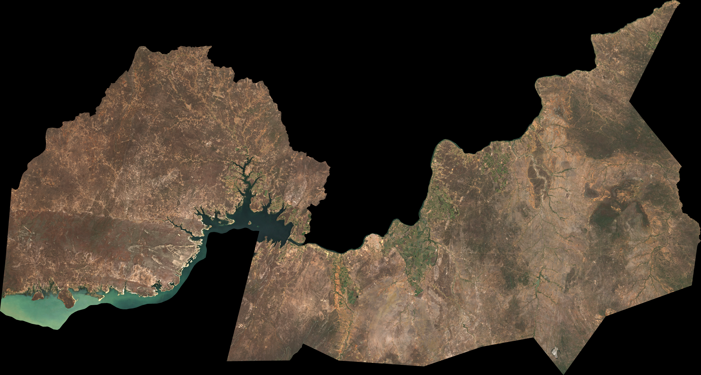

Composição RGB do recorte espacial da área de estudo — Elaboração própria.

### Caracterização da área de estudo

PERFIL AMBIENTAL E PRODUTIVO

Submédio do São Francisco

  

    

      ~24 mil km²
    

    

      Extensão territorial estimada
    

  

  

    

      400–600 mm
    

    

      Precipitação anual
    

  

  

    

      Acima de 24°C
    

    

      Temperatura média
    

  

  

    

      Clima
    

    

      Semiárido quente, com chuvas irregulares, elevada evapotranspiração e déficit hídrico.
    

  

  

    

      Solos predominantes
    

    

      Neossolos, Luvissolos e Planossolos, frequentemente rasos e suscetíveis à erosão.
    

  

  

    

      Atividades produtivas
    

    

      Pecuária extensiva de caprinos, ovinos e bovinos, agricultura de sequeiro e fruticultura irrigada.
    

  

  

    

      Vulnerabilidade ambiental
    

    

      Superpastejo, degradação do solo, desmatamento, secas e risco de desertificação.
    

  

SENSORIAMENTO REMOTO

Vigor da vegetação — NDVI

O Índice de Vegetação por Diferença Normalizada (NDVI) permite acompanhar o vigor relativo da cobertura vegetal e suas variações temporais.

  

    

      0,3984
    

    

      NDVI médio histórico
    

  

  

    

      0,3755
    

    

      NDVI médio em 2025
    

  

  <svg viewBox="0 0 800 280" style="width:100%; height:auto; display:block;" role="img" aria-label="Evolução do NDVI médio regional entre 2021 e 2025">
    <g stroke="#dce5da" stroke-dasharray="4 5">
      <line x1="70" y1="40" x2="750" y2="40"/>
      <line x1="70" y1="85" x2="750" y2="85"/>
      <line x1="70" y1="130" x2="750" y2="130"/>
      <line x1="70" y1="175" x2="750" y2="175"/>
      <line x1="70" y1="220" x2="750" y2="220"/>
    </g>
    <g fill="#64786b" font-size="12" text-anchor="end">
      <text x="58" y="44">0,450</text>
      <text x="58" y="89">0,425</text>
      <text x="58" y="134">0,400</text>
      <text x="58" y="179">0,375</text>
      <text x="58" y="224">0,350</text>
    </g>
    <path d="M100 157.36 L260 133.24 L420 132.88 L580 77.44 L740 174.10 L740 220 L100 220 Z" fill="#d0e0d6" opacity="0.5"/>
    <polyline points="100,157.36 260,133.24 420,132.88 580,77.44 740,174.10" fill="none" stroke="#527060" stroke-width="3" stroke-linejoin="round"/>
    <circle cx="100" cy="157.36" r="5" fill="#527060"/>
    <circle cx="260" cy="133.24" r="5" fill="#527060"/>
    <circle cx="420" cy="132.88" r="5" fill="#527060"/>
    <circle cx="580" cy="77.44" r="5" fill="#527060"/>
    <circle cx="740" cy="174.10" r="6" fill="#a68143"/>
    <g font-size="14" fill="#294c3d" text-anchor="middle" font-weight="600">
      <text x="100" y="142">0,3848</text>
      <text x="260" y="117">0,3982</text>
      <text x="420" y="117">0,3984</text>
      <text x="580" y="61">0,4292</text>
      <text x="740" y="157">0,3755</text>
    </g>
    <g font-size="13" fill="#64786b" text-anchor="middle">
      <text x="100" y="250">2021</text>
      <text x="260" y="250">2022</text>
      <text x="420" y="250">2023</text>
      <text x="580" y="250">2024</text>
      <text x="740" y="250">2025</text>
    </g>
  </svg>

Em 2025, a região apresentou redução do NDVI médio em relação a 2024 e à média histórica, indicando menor vigor relativo da vegetação. Esse indicador auxilia na caracterização ambiental e integra as variáveis do sistema de recomendação agroflorestal.

Fonte: NASA MODIS — Processamento de dados do projeto Restaura Caatinga. Elaboração própria.

### Resultado do modelo

VALIDAÇÃO FUNCIONAL

Sistema de recomendação agroflorestal

A figura apresenta o desempenho funcional do modelo KNN para municípios do Submédio do Rio São Francisco, considerando a distância euclidiana ponderada entre os cenários avaliados e os padrões de referência.

Validação funcional do sistema de recomendação para Juazeiro, Casa Nova, Curaçá e Sobradinho — Elaboração própria.

  

    Os resultados indicam que <strong>Casa Nova</strong>, <strong>Curaçá</strong> e <strong>Juazeiro</strong> apresentaram distâncias abaixo do limiar de 4,0, indicando maior similaridade com os cenários de referência e viabilidade de recomendação.
  

  

    Já <strong>Sobradinho</strong> apresentou distância superior ao limiar adotado, sendo classificado como <em>similaridade insuficiente</em>, o que sugere menor aderência aos padrões utilizados pelo modelo.
  

## Considerações finais <!--{ as="img" mode="tour" }-->

### <!--{ src="assets\final.jpg" style="background:rgba(20,30,15,0.35); backdrop-filter:none; -webkit-backdrop-filter:none; box-shadow:none; border:none; border-radius:8px; width:600px; max-width:80%;" }-->

RESTAURA CAATINGA <!--{ style="font-size:11px;letter-spacing:3px;color:#e0e8d4;margin:0 0 12px;" }-->

#### O futuro da Caatinga começa com as escolhas de hoje. <!--{ style="font-size:23px;line-height:1.3;color:white;font-weight:600;text-shadow:0 2px 5px #333;" }-->

Produzir sem destruir é conciliar desenvolvimento econômico e conservação ambiental. Por meio da ciência, da tecnologia e do manejo sustentável, podemos construir um futuro mais resiliente para o semiárido brasileiro. <!--{ style="font-size:14px;line-height:1.7;color:white;text-shadow:0 2px 5px #333;" }-->

*Ciência de dados a serviço da sustentabilidade.* <!--{ style="font-size:12px;color:#e0e8d4;" }-->

## Referências e repositório

  

    CÓDIGO E DOCUMENTAÇÃO
  

  

    REPOSITÓRIO DO PROJETO
  

  <a href="https://github.com/SabrinaScientist/ftl_capstone_restaura_caatinga" target="_blank" rel="noopener noreferrer" style="font-family:monospace; font-size:14px; color:#e0e8d4; text-decoration:underline; overflow-wrap:anywhere;">
    github.com/SabrinaScientist/ftl_capstone_restaura_caatinga
  </a>
  

    Documentação · Engenharia de dados · Sensoriamento remoto · Machine Learning
  

  

  

    REFERÊNCIAS
  

  

    [1]
    NASCIMENTO, Fátima Juliana Lacerda do. <strong>Degradação de pastagens: causas, consequências e caminho para a recuperação.</strong> Revista Multidisciplinar do Nordeste Mineiro, v. 8, n. 1, p. 1–12, 2025. Disponível em:
    <a href="https://doi.org/10.61164/rmnm.v8i1.3836" target="_blank" rel="noopener noreferrer" style="color:#c7dbc9;">10.61164/rmnm.v8i1.3836</a>.
    Acesso em: 1 nov. 2026.
  

  

    [2]
    TRINDADE, Guto. <strong>Fazenda Cajazeira — Pecuária regenerativa.</strong> Mundo Novo, Bahia. Perfil institucional:
    <a href="https://www.instagram.com/gutotrindade.cajazeira/" target="_blank" rel="noopener noreferrer" style="color:#c7dbc9;">@gutotrindade.cajazeira</a>.
  

  

    [3]
    MINISTÉRIO DA AGRICULTURA E PECUÁRIA (MAPA). <strong>Conversão de pastagens degradadas em sistemas de produção agropecuários e florestais sustentáveis: priorização de áreas e estimativas de investimentos – Bahia.</strong> Piracicaba, SP: MAPA, 2024.
    <a href="https://agroicone.com.br/wp-content/uploads/2025/03/pncpd-BA2012.pdf" target="_blank" rel="noopener noreferrer" style="color:#c7dbc9;">Acessar publicação</a>.
    Acesso em: 1 nov. 2026.
  

  

    [4]
    ROCHA, Washington J. S. Franca et al. <strong>Towards Uncovering Three Decades of LULC in the Brazilian Drylands: Caatinga Biome Dynamics (1985–2019).</strong> Land, v. 13, n. 8, art. 1250, 2024. DOI:
    <a href="https://doi.org/10.3390/land13081250" target="_blank" rel="noopener noreferrer" style="color:#c7dbc9;">10.3390/land13081250</a>.
    Acesso em: 1 nov. 2026.
  

  

    [5]
    MAPBIOMAS. <strong>Mapeamento Anual de Cobertura e Uso da Terra no Brasil — Coleção 10.</strong> Disponível em:
    <a href="https://doi.org/10.58053/MapBiomas/8OVXBN" target="_blank" rel="noopener noreferrer" style="color:#c7dbc9;">Base de dados MapBiomas — Coleção 10</a>.
    Acesso em: 1 nov. 2026.
  

  

    [6]
    MAPBIOMAS. <strong>Caatinga: Algorithm Theoretical Basis Document (ATBD) – Appendix, Collection 11, Version 4.</strong> Brazil, 2026. Disponível em:
    <a href="https://github.com/mapbiomas/brazil-caatinga/tree/main/lulc_30m_landsat/collection_11" target="_blank" rel="noopener noreferrer" style="color:#c7dbc9;">Documentação técnica</a>.
    Acesso em: 1 nov. 2026.
  

  

  

    FONTES DE DADOS E PLATAFORMAS
  

  

    <a href="https://modis.gsfc.nasa.gov/" target="_blank" rel="noopener noreferrer" style="color:#c7dbc9;">NASA MODIS</a> ·
    <a href="https://earthengine.google.com/" target="_blank" rel="noopener noreferrer" style="color:#c7dbc9;">Google Earth Engine</a> ·
    <a href="https://brasil.mapbiomas.org/" target="_blank" rel="noopener noreferrer" style="color:#c7dbc9;">MapBiomas</a> ·
    <a href="https://www.fao.org/" target="_blank" rel="noopener noreferrer" style="color:#c7dbc9;">FAO</a> ·
    <a href="https://www.ibge.gov.br/" target="_blank" rel="noopener noreferrer" style="color:#c7dbc9;">IBGE</a>
  

  

  

    

      RESTAURA CAATINGA
    

    

      Desenvolvido por Sabrina Lisboa.
    

    

      Projeto Capstone | FTL Brazil — PNUD | 2026
    

    

      Ciência de dados a serviço da sustentabilidade.
    

  

